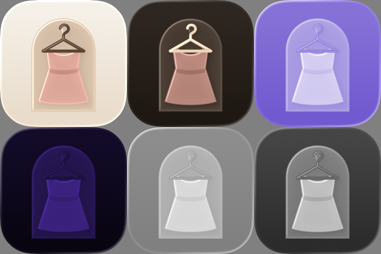

# App icon

A placeholder icon for the TestFlight builds, drawn in Phase 18 (16 October 2026). Jose can replace it at any time.



## What it is

A dress on a hanger, hanging in an arched nook, on the room's warm wall. The colours come from the app: the wall and floor tokens for the background, the espresso accent for the hanger (latte in dark, as the app's accent is), and a dusty pink for the dress, close to the pink blouse in the sample closet. There's no text and no Apple artwork in it.

It's an Icon Composer file, `NiftyOutfitNook/AppIcon.icon`, with three layers so iOS 26 can give it depth and Liquid Glass:

| Layer | Light | Dark |
|---|---|---|
| `hanger.svg` | espresso `#4B3628`, no translucency | latte `#DCC3A8` |
| `dress.svg` | dusty pink `#DCA597`, waistband `#C68D80` | `#B8867A`, waistband `#A07065` |
| `nook.svg` | latte `#D3BDA6` | `#463930` |
| background | gradient `#F6F0E8` to `#E9DCCB` | gradient `#2E2620` to `#1E1813` |

In the tinted appearances the nook is drawn at 45% so the dress still stands out from it. `preview.png` was made with the `ictool` inside Icon Composer:

```sh
ictool NiftyOutfitNook/AppIcon.icon --export-image --output-file out.png --platform iOS --rendition Dark --width 256 --height 256 --scale 1
```

The renditions are `Default`, `Dark`, `TintedLight`, `TintedDark`, `ClearLight` and `ClearDark`.

## Replacing it

Open `NiftyOutfitNook/AppIcon.icon` in Icon Composer (in Xcode, Open Developer Tool > Icon Composer), change it and save. Keep the name `AppIcon`, since `ASSETCATALOG_COMPILER_APPICON_NAME` in `Configs/App.xcconfig` points to it, and `scripts/check-archive.sh` checks it's in the app. The build makes the older sizes from it, so there's no `AppIcon.appiconset` any more. Update `preview.png` too.
